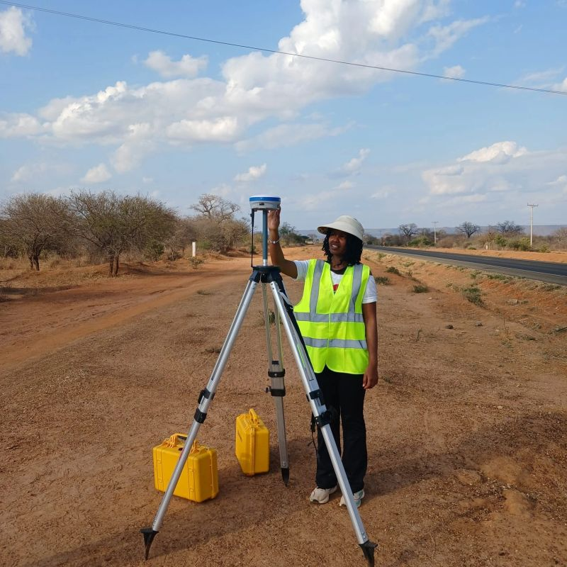

# Mapping a more equitable Africa through data

  Geospatial and Data Analyst
  Climate & Social Impact Analytics
  Nairobi, Kenya

{ .profile-image }

I use satellite imagery, statistical models and business intelligence tools to investigate questions about the environment, markets and work. My background in Surveying Technology informs how I check the data behind each map and report.

Browse [Data Engineering & Automation](projects/index.md#data-engineering-automation) and [Personal Projects](projects/index.md#personal-projects), or start with a case study below.

## Selected work

- [Labour force participation gaps](projects/labour-participation.md) · Compare women’s and men’s participation rates across eight African countries in Power BI.
- [Nakuru vegetation change](projects/nakuru-ndvi.md) · Measure how much land crossed a vegetation threshold between two April–June seasons.
- [Kenya maize price forecasting](projects/kenya-maize-forecasting.md) · Test whether a model can improve on using last month’s price.

{ .about-image }

*Fieldwork using RTK GNSS positioning during my professional attachments in Kenya.*

## Get in touch

I am open to opportunities in climate analytics, geospatial data science, and social impact research.

  <a href="mailto:jecinta.w.kinyanjui@gmail.com" style="color: #ffffff; margin-right: 8px;">✉ jecinta.w.kinyanjui@gmail.com</a> |
  <a href="tel:+254793656395" style="color: #ffffff; margin: 0 8px;">📞 +254 793 656 395</a> |
  <a href="https://www.linkedin.com/in/jecinta-wanjiru-" style="color: #ffffff; margin: 0 8px;">LinkedIn</a> |
  <a href="https://github.com/Wanjiru-1" style="color: #ffffff; margin-left: 8px;">GitHub</a>

[See my work](projects/){ .md-button .md-button--primary }
[Download CV](assets/Jecinta_Wanjiru_CV.pdf){ .md-button }
