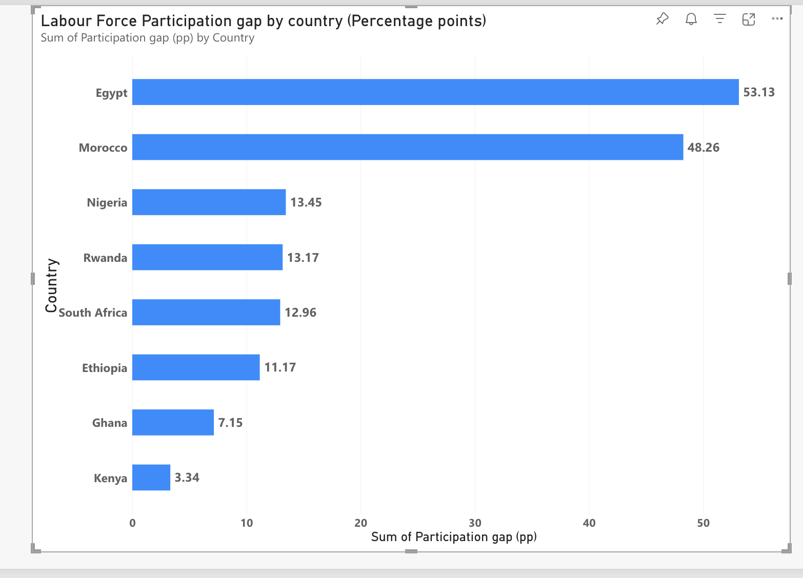
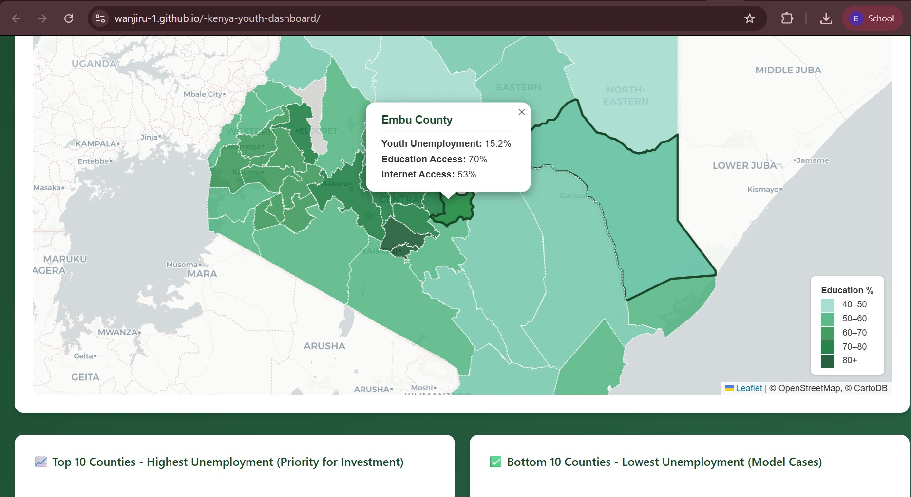

# Data Analytics & Business Intelligence

-   

    **Labour force participation gaps across eight African countries**

    Egypt and Morocco recorded gaps above 48 percentage points. Compare all eight countries in a Power BI report with an ArcGIS boundary map.

    [Read the report →](labour-participation.md)

-   

    **Kenya Youth Opportunity Dashboard**

    *HTML5 + Leaflet + Plotly | 2026*

    Interactive choropleth dashboard using synthetic indicators to explore youth employment, education access, and digital connectivity across all 47 Kenyan counties.

    `JavaScript` `Leaflet.js` `Plotly.js` `Data Storytelling` `Choropleth`

    [Read full case study →](kenya-youth-dashboard.md)

