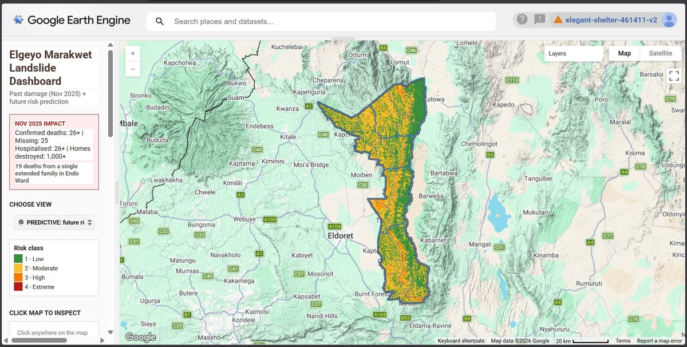

# Elgeyo Marakwet Landslide Dashboard

*November 2025 | Google Earth Engine + JavaScript + machine learning | Work in progress*

**Tags:** `Google Earth Engine` `JavaScript` `Machine Learning` `Remote Sensing` `Sentinel-2` `Sentinel-1 SAR` `CHIRPS` `SRTM` `Disaster Risk` `Work in Progress` `Kenya`



## The Problem

This project examines landslide susceptibility in Elgeyo Marakwet County and the November 2025 event. Impact figures shown in earlier drafts have not yet been verified against an authoritative incident record, so casualty, missing-person, and damage counts remain unconfirmed.

Elgeyo Marakwet has experienced repeated landslide events since 2010 (Kaben, Chesongoch 2012, Muino-Nyarkulian-Parua 2019, Liter-Chesegon 2020). Despite this recurring pattern, county disaster officers have lacked a quick-access tool to identify which slopes are most vulnerable before the next rainfall event.

## The Objective

Develop a Google Earth Engine dashboard to explore landslide susceptibility across the county and inspect satellite evidence related to the November 2025 event. The dashboard is still being debugged and is not yet presented as a validated operational planning tool.

## Methodology

The analysis combines six environmental factors into a weighted susceptibility index. I also used machine-learning functionality in Google Earth Engine as part of the project. I am still resolving errors in the dashboard and using AI assistance to investigate and debug them. The exact model configuration and validation results will be documented after I confirm them. The current weighted-index formulation is:

```
Risk = 0.35 × slope
     + 0.20 × rainfall (7-day antecedent)
     + 0.15 × vegetation loss (NDVI change)
     + 0.15 × land cover vulnerability
     + 0.10 × slope curvature
     + 0.05 × soil moisture
```

Each input is normalised to a 0-to-1 range and combined into a final score, with higher scores indicating higher physical susceptibility to slope failure during heavy rain.

Four interactive layers are available in the dashboard:

* **Before/after Sentinel-2 imagery** for visual change detection at the impact sites
* **Sentinel-1 SAR backscatter difference** for cloud-penetrating verification
* **CHIRPS rainfall analysis** showing the 7-day rainfall total that triggered the event
* **Susceptibility classification** across the entire county, with risk classes from low to extreme

## Data Sources and Attribution

| Dataset | Provider | Use |
|---|---|---|
| Sentinel-2 SR Harmonized | ESA / Copernicus | Optical imagery, NDVI change detection |
| Sentinel-1 GRD IW | ESA / Copernicus | SAR backscatter (cloud-penetrating) |
| CHIRPS Daily | UCSB Climate Hazards Center | Rainfall (5 km, 1981 to present) |
| SRTM 30 m | NASA / USGS | Elevation, slope, curvature derivation |
| ESA WorldCover 10 m | ESA / Copernicus | Land cover classification |
| SMAP L4 | NASA | Soil moisture at 9 km |
| Custom Elgeyo Marakwet boundaries | Kenya county and sub-county GeoJSONs | Administrative boundaries |
| Event impact statistics | Kenya Red Cross, OCHA, CNN, Daily Nation | Casualty and displacement figures |

All Earth observation datasets are openly accessible through Google Earth Engine's public catalog.

## Tech Stack

* **Google Earth Engine** (JavaScript Code Editor) for satellite data processing and the interactive dashboard
* **Sentinel-2** and **Sentinel-1** Earth observation imagery
* **GeoJSON** vector boundary handling
* **GEE Apps** for public deployment

## Outcomes and Impact

The dashboard delivers:

* A county-scale susceptibility map showing slopes most likely to fail in future events
* Visual evidence of the November 2025 disturbance via NDVI change detection
* Cross-validation between optical (Sentinel-2) and radar (Sentinel-1) imagery
* Rainfall trigger analysis linking antecedent rainfall to slope failure

The work supports disaster management officers, NGOs working on climate resilience, and communities living on slope-prone terrain.

## Code and Live Outputs

## Code and Live Dashboard

[:material-launch: Open Live Dashboard in GEE](https://elegant-shelter-461411-v2.projects.earthengine.app/view/elgeyo-marakwet-landslide-risk-dashboard){ .md-button .md-button--primary }
[:fontawesome-brands-github: View Source Code](https://github.com/Wanjiru-1/ELGEYO_MARAKWET-LANDSLIDES-DASHBOARD){ .md-button }

> Note: This dashboard is hosted on Google Earth Engine. Due to GEE's embed restrictions, it opens in a new tab. The full interactive experience awaits on the linked page.

**Direct links:**

* **GEE App URL:** https://elegant-shelter-461411-v2.projects.earthengine.app/view/elgeyo-marakwet-landslide-risk-dashboard
* **GitHub Repository:** https://github.com/Wanjiru-1/ELGEYO_MARAKWET-LANDSLIDES-DASHBOARD
* **Main Script:** `elgeyo_marakwet_landslides.js`
* **Boundary Data:** GeoJSON files for Elgeyo Marakwet County included in repository

## Reflections

This project taught me how to combine multiple Earth observation datasets into a single decision-support tool, and how to handle both optical and radar inputs in the same analysis. Next steps include resolving the current dashboard errors, documenting the machine-learning method used in GEE, validating outputs against suitable historical landslide records, and verifying event impact figures against an authoritative incident record.

---

[← Back to all projects](../) | [Home](../../)
