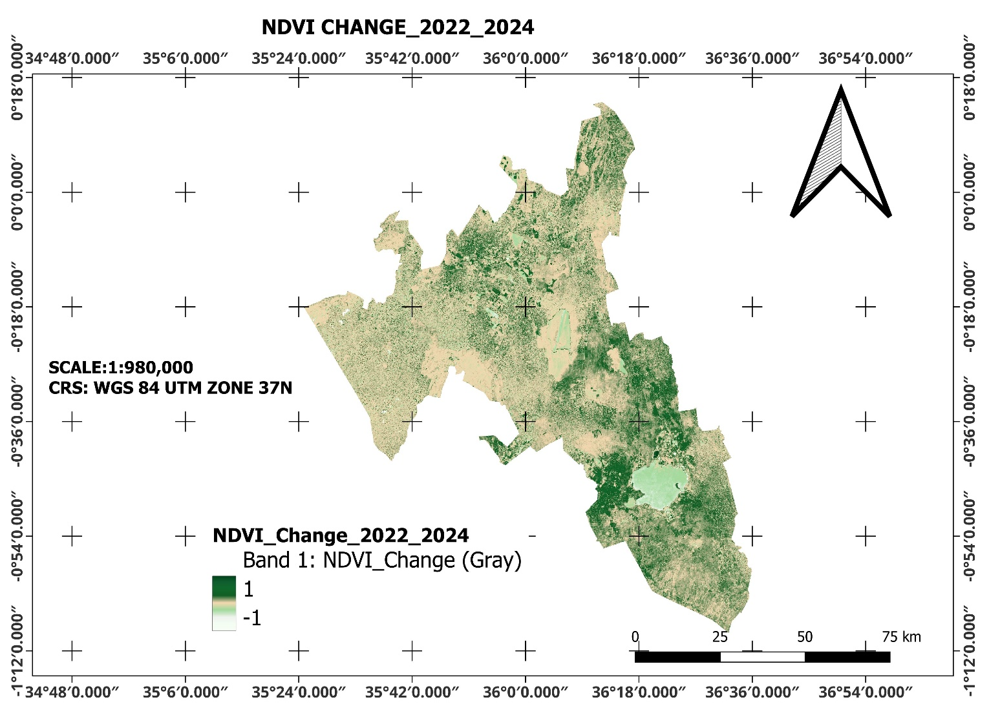
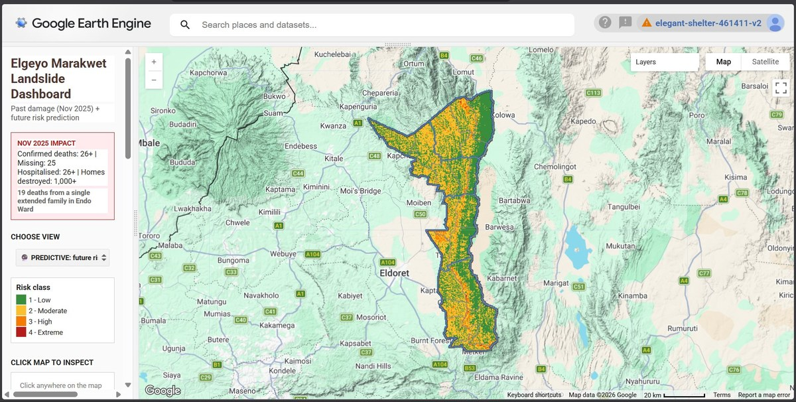
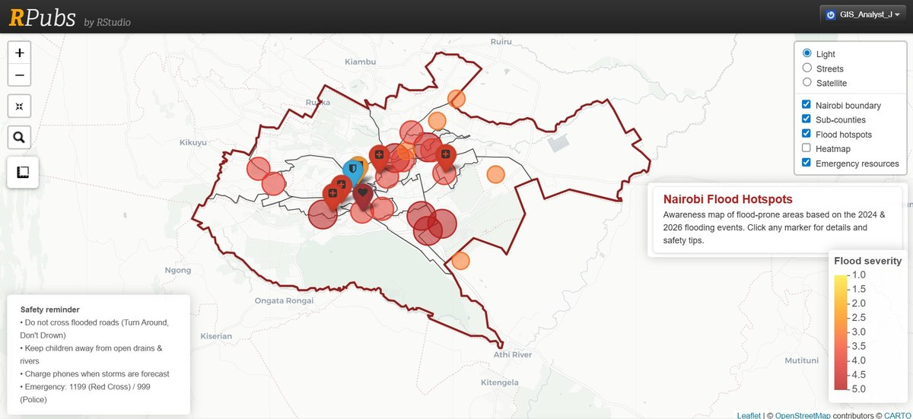

# Geospatial & Earth Observation

-   

    **NAKURU NDVI ANALYSIS (DROUGHT VS FLOOD YEAR)**

    *Google Earth Engine + QGIS | Final-year research, July 2025*

    Sentinel-2 NDVI analysis comparing two April–June seasons, with a reported gain of 92,496.4 hectares above the vegetation threshold. Explore the live app and read the complete research.

    `GEE` `JavaScript` `Sentinel-2` `NDVI` `CHIRPS` `QGIS`

    [Explore project →](nakuru-ndvi.md) · [Open live app ↗](https://elegant-shelter-461411-v2.projects.earthengine.app/view/nakuru-ndvi-analysis){ target="_blank" rel="noopener" }

    [Read the full research (PDF)](../assets/research/nakuru-ndvi-research.pdf)

-   

    **Elgeyo Marakwet Landslide Dashboard**

    *Google Earth Engine + JavaScript + ML | November 2025 · Work in progress*

    Exploratory county-scale susceptibility analysis using GEE machine-learning tools and satellite data. Dashboard errors are still being debugged with AI assistance. November 2025 impact figures await authoritative confirmation.

    `GEE` `JavaScript` `Machine Learning` `Sentinel-1` `Sentinel-2` `CHIRPS` `SRTM`

    [Read full case study →](elgeyo-landslide.md)

-   

    **Nairobi Flood Hotspots Map**

    *R + Leaflet | 2024 to 2026 events*

    Public-facing interactive Leaflet map identifying 20 flood-prone neighbourhoods across Nairobi, with severity scores, emergency resources, and river-basin context.

    `R` `Leaflet.js` `GADM` `Cartography` `Urban Resilience`

    [Read full case study →](nairobi-flood-hotspots.md)

