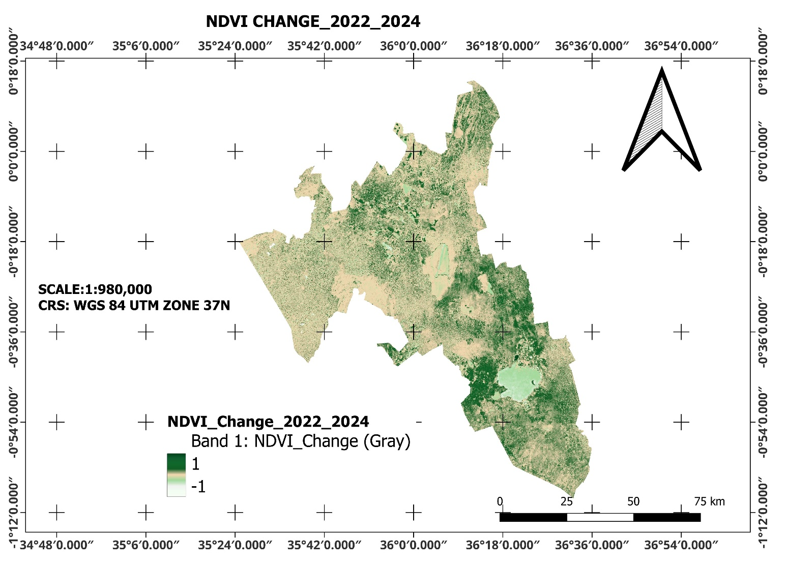
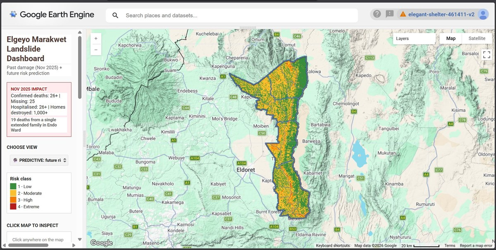
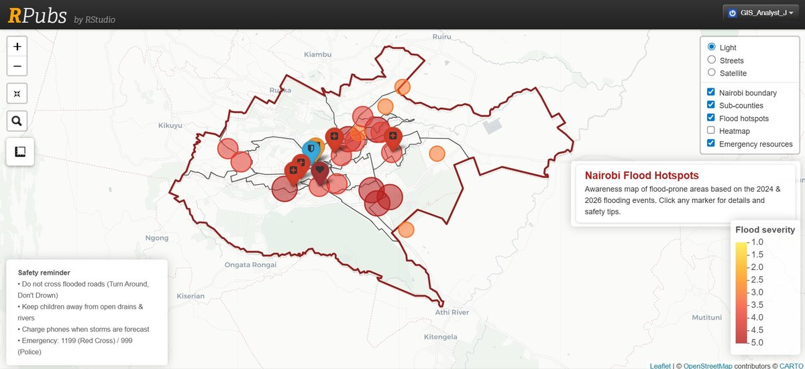
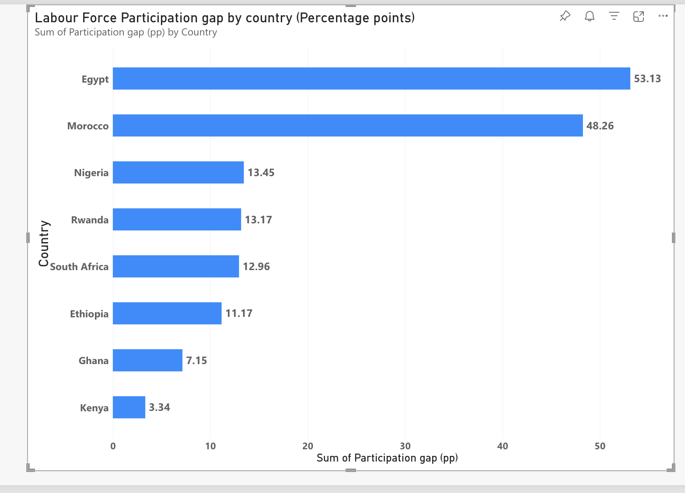
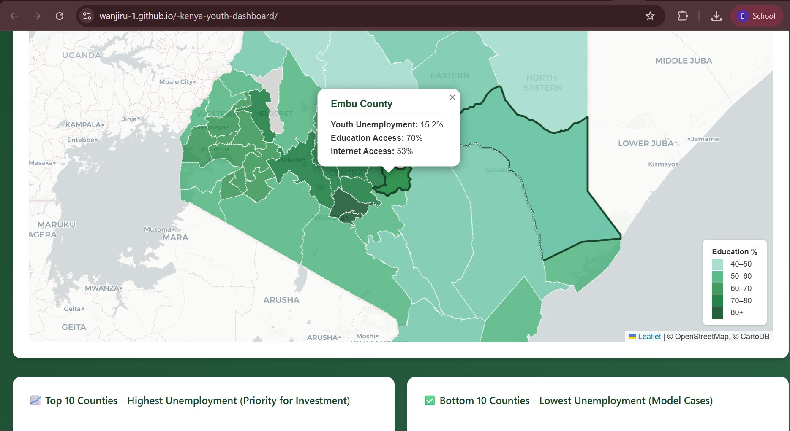

# Projects

Geospatial, AI, and data analytics projects addressing climate risk, disaster preparedness, public health evidence, agriculture, and youth opportunity in Kenya and across selected African countries. Each project presents its question, methods, data sources, results, and limitations.

## Geospatial & Earth Observation

-   

    **NAKURU NDVI ANALYSIS (DROUGHT VS FLOOD YEAR)**

    *Google Earth Engine + QGIS | Final-year research, July 2025*

    Sentinel-2 NDVI analysis comparing two April–June seasons, with a reported gain of 92,496.4 hectares above the vegetation threshold. Explore the live app and read the complete research.

    `GEE` `JavaScript` `Sentinel-2` `NDVI` `CHIRPS` `QGIS`

    [Explore project →](nakuru-ndvi.md) · [Open live app ↗](https://elegant-shelter-461411-v2.projects.earthengine.app/view/nakuru-ndvi-analysis){ target="_blank" rel="noopener" }

    [Read the full research (PDF)](../assets/research/nakuru-ndvi-research.pdf)

-   

    **Elgeyo Marakwet Landslide Dashboard**

    *Google Earth Engine + JavaScript + ML | November 2025 · Work in progress*

    Exploratory county-scale susceptibility analysis using GEE machine-learning tools and satellite data. Dashboard errors are still being debugged with AI assistance. November 2025 impact figures await authoritative confirmation.

    `GEE` `JavaScript` `Machine Learning` `Sentinel-1` `Sentinel-2` `CHIRPS` `SRTM`

    [Read full case study →](elgeyo-landslide.md)

-   

    **Nairobi Flood Hotspots Map**

    *R + Leaflet | 2024 to 2026 events*

    Public-facing interactive Leaflet map identifying 20 flood-prone neighbourhoods across Nairobi, with severity scores, emergency resources, and river-basin context.

    `R` `Leaflet.js` `GADM` `Cartography` `Urban Resilience`

    [Read full case study →](nairobi-flood-hotspots.md)

## Data Analytics & Business Intelligence

-   

    **Labour force participation gaps across eight African countries**

    Egypt and Morocco recorded gaps above 48 percentage points. Compare all eight countries in a Power BI report with an ArcGIS boundary map.

    [Read the report →](labour-participation.md)

-   

    **Kenya Youth Opportunity Dashboard**

    *HTML5 + Leaflet + Plotly | 2026*

    Interactive choropleth dashboard using synthetic indicators to explore youth employment, education access, and digital connectivity across all 47 Kenyan counties.

    `JavaScript` `Leaflet.js` `Plotly.js` `Data Storytelling` `Choropleth`

    [Read full case study →](kenya-youth-dashboard.md)

## Data Science, AI & Machine Learning

-   **AI Evidence Evaluation for Kenya Health Census**

    *Python + TF-IDF + Sentence Transformers + local Qwen | 2026*

    Compared keyword and semantic retrieval on Kenya's 2023 health facility census and evaluated grounded LLM answers, citations, denominator handling, and abstention.

    `Python` `Retrieval Evaluation` `LLM` `Public Health`

    [Read the case study →](kenya-health-census-assistant.md) · [Open evaluation dashboard ↗](../assets/dashboards/kenya-health-census-evaluation.html){ target="_blank" rel="noopener" }

-   **Kenya Maize Price Forecasting**

    *Python + scikit-learn + local Qwen | 2026*

    Historical one-month-ahead forecast comparison across Eldoret, Nairobi, and Nakuru, with an interactive evidence dashboard and Tableau-ready datasets.

    `Python` `Random Forest` `Forecast Evaluation` `Tableau`

    [Read the case study →](kenya-maize-forecasting.md) · [Open forecast dashboard ↗](../assets/dashboards/kenya-maize-dashboard.html){ target="_blank" rel="noopener" }

## Data Engineering & Automation

**Membership registration workflow · Institution of Surveyors of Kenya.** Connected ArcGIS Survey123, Excel and the membership database using Make.com to digitise conference registration.

**Coffee farm records and cartographic automation · DRSRS.** Digitised and validated more than 300 smallholder coffee farm parcels in ArcGIS Pro and automated repetitive map production tasks using Python and Google Earth Engine.

[Read about these workplace projects](../experience.md)

## Personal Projects

### Skin in the Game

*Accountability app · In development*

I’m building an app for people who want to follow through on a goal with encouragement from someone they know. The interactive demo lets you explore check-ins from your own perspective or switch to Maya, a sample accountability partner. Demo changes stay on your device.

[Try the Skin in the Game demo](https://getskininthegame.pages.dev/demo#today)
