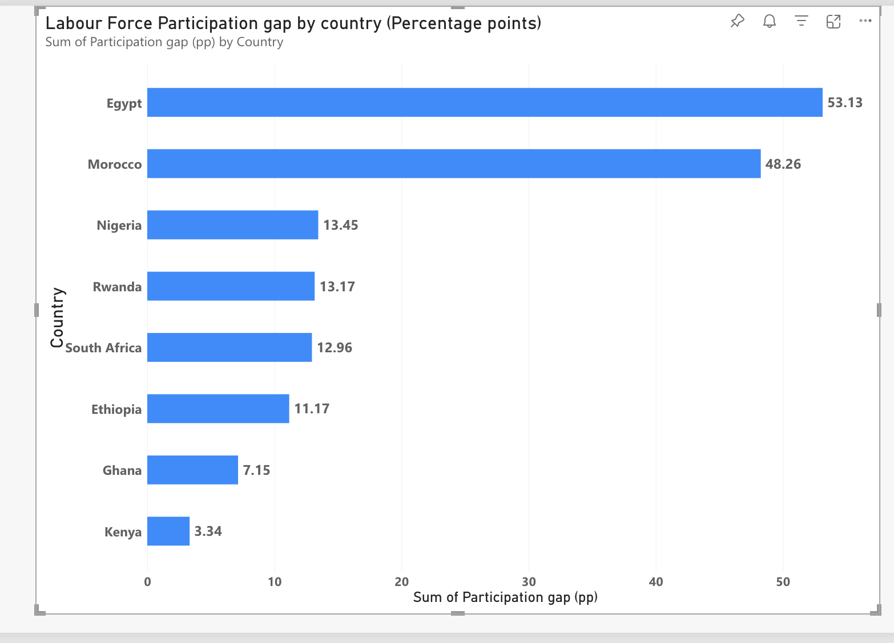
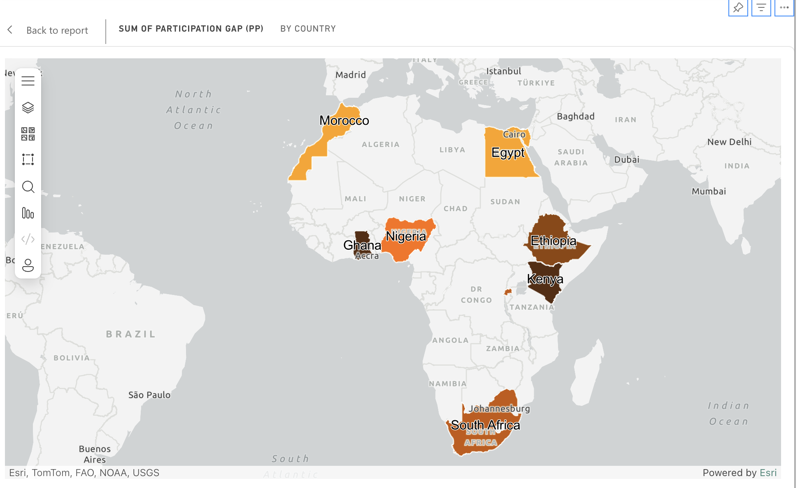

# Labour force participation gaps across eight African countries

**Independent project · Power BI and ArcGIS for Power BI**

Where was the difference between women’s and men’s labour force participation widest among the eight countries in the dataset? Egypt ranked first at **53.13 percentage points**, followed by Morocco at **48.26**. Nigeria, third at **13.45**, was much closer to Rwanda and South Africa than to either of the two leaders.

*Figure 1. Each bar shows the male participation rate minus the female participation rate. Labels give the difference in percentage points.*

## What the gap captures

Kenya had the smallest gap at **3.34 points**. Ethiopia had the highest female participation rate in the file at **75.03%**, compared with **72.72%** in Kenya. Ethiopia’s male rate was also higher, producing a wider gap of **11.17 points**. The choice of metric therefore changes which country stands out.

## Mapping the comparison

*Figure 2. Bright orange marks the highest gap class, including Egypt and Morocco. Dark brown marks the lowest class, including Kenya. Grey countries are outside the sample. Rwanda is the small shaded area southwest of Kenya.*

## Method and verification

I used the female and male labour force participation indicators labelled as modelled ILO estimates in the supplied CSV. Each rate measures participation among people aged 15 or older of the corresponding sex. I loaded an eight-row table containing the country, both rates and their calculated gap into Power BI, ranked the countries with a horizontal bar chart and used the same gap to colour country boundaries in ArcGIS.

I checked Egypt’s bar against the original rates: 68.253% − 15.123% = 53.130 percentage points. Each country has one record, so the visual’s default “Sum” gives the individual country value.

## Scope

The source filename is `Gender_parity_2022.csv`. It contains no publisher link or observation year for each indicator. These figures describe the eight selected countries. A single cross-section cannot establish a trend, explain why participation differs, or measure a training programme’s impact.
