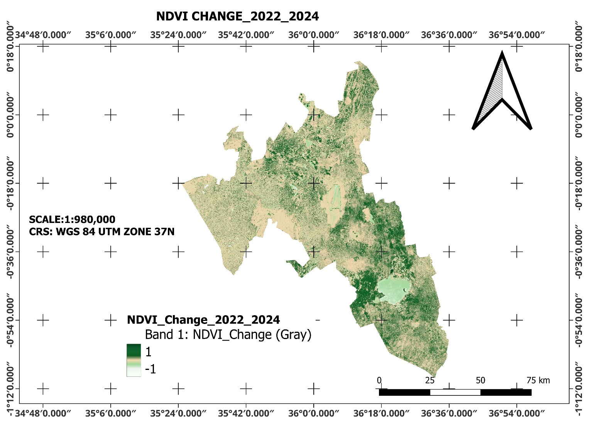

# NAKURU NDVI ANALYSIS (DROUGHT VS FLOOD YEAR)

*Final-year research | July 2025 | Jecinta Wanjiru Kinyanjui*

**Tags:** `Google Earth Engine` `JavaScript` `Sentinel-2` `NDVI` `QGIS` `CHIRPS` `Remote Sensing`

How did vegetation greenness change between the April–June seasons of 2022 and 2024 in Nakuru County? My final-year project used satellite imagery and GIS to map the difference and compare it with rainfall variability.

[Open live GEE app](https://elegant-shelter-461411-v2.projects.earthengine.app/view/nakuru-ndvi-analysis){ .md-button .md-button--primary target="_blank" rel="noopener" }
[Read the full research (PDF)](../assets/research/nakuru-ndvi-research.pdf){ .md-button target="_blank" rel="noopener" }

## Explore the live app

Pan and zoom around Nakuru County and use the app's layer controls to compare NDVI in 2022, NDVI in 2024, and the change between them.

  <iframe src="https://elegant-shelter-461411-v2.projects.earthengine.app/view/nakuru-ndvi-analysis" title="Live Nakuru NDVI analysis in Google Earth Engine" height="650" loading="lazy" allowfullscreen></iframe>

If the map does not load in your browser, [open the live app in a new tab](https://elegant-shelter-461411-v2.projects.earthengine.app/view/nakuru-ndvi-analysis){ target="_blank" rel="noopener" }.

## The research question

Nakuru combines forests, agricultural land, wetlands, and growing urban areas. I wanted to quantify changes in vegetation greenness during two contrasting rainfall periods using accessible Earth observation tools. The report compares April–June 2022, described as the drought period, with April–June 2024, described as the flood period.

## Data and workflow

1. Define the Nakuru County boundary using administrative boundary data from the Humanitarian Data Exchange.
2. Filter Sentinel-2 Level-2A surface reflectance imagery in Google Earth Engine and mask unsuitable pixels using the Scene Classification Layer.
3. Build seasonal composites and calculate **NDVI = (B8 − B4) / (B8 + B4)** using the near-infrared and red bands.
4. Subtract the 2022 NDVI layer from the 2024 layer to map changes in greenness.
5. Apply an **NDVI > 0.3** threshold and sum pixel areas in GEE to estimate vegetated area in hectares.
6. Compare vegetation patterns with CHIRPS rainfall data and export maps for cartographic presentation in QGIS.

Sentinel-2's red and near-infrared bands have a native resolution of 10 metres; the report describes a 30-metre scale for area analysis. The threshold identifies green cover and does not distinguish forests, crops, and grassland.

## Results

| Measure | Reported area |
|---|---:|
| Vegetated area, 2022 | 381,091.4 ha |
| Vegetated area, 2024 | 473,587.8 ha |
| Net increase | 92,496.4 ha |
| Relative increase from the 2022 baseline | **24.3%** |

*Source: Table 3 of the original report. The relative increase is recalculated as 92,496.4 ÷ 381,091.4 × 100. This corrects the 10.8% figure in the original text. The pie chart's 44.6% and 55.4% are shares of the two years' combined vegetated area, not percentages of Nakuru County.*

The comparison indicates more area above the selected NDVI threshold in 2024. The rainfall comparison provides context, but this study does not establish that flooding alone caused the increase.

*Original map reproduced from the research report; it is a static figure. Use the live app above to explore the layers interactively.*

## What I learned

This project connected cloud-based satellite processing, JavaScript analysis, rainfall comparison, and map design. It also showed why clear thresholds, consistent spatial scales, and careful interpretation matter as much as producing a map.

A two-period comparison cannot isolate rainfall effects from farming cycles, land-use change, or other drivers. NDVI measures greenness rather than biodiversity or ecological recovery directly. Future work should add longer time series, field validation, and tests of how the chosen threshold affects the result.

## Full research

[Read the full research (PDF)](../assets/research/nakuru-ndvi-research.pdf){ .md-button .md-button--primary target="_blank" rel="noopener" }
[Download the original Word report](../assets/research/nakuru-ndvi-research.docx){ .md-button }

The Word file is the original report. The PDF is a reading copy converted from it; pagination can differ. Both include the maps, methodology, references, and original wording. The percentage correction above applies to this portfolio summary.

[← Back to all projects](index.md)
